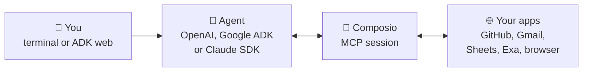

<div align="center">

# Agents SDK Tests

**The same idea built with three agent SDKs, all connected to apps through Composio.**

OpenAI Agents, Google ADK (Gemini) and the Claude Agent SDK, side by side,<br>
so you can compare how each one handles tools, sessions and MCP.

<br>


[**Agents**](#agents) · [**How it works**](#how-it-works) · [**Getting started**](#getting-started) · [**Running each agent**](#running) · [**Project structure**](#project-structure) · [**Troubleshooting**](#troubleshooting)

</div>

<br>

> [!NOTE]
> These are test agents for comparing SDKs, not production apps. You need your own Composio account and model keys, and each agent only works once the apps it uses are connected in Composio.

<a id="agents"></a>

## 🤖 Agents

| Agent | SDK and model | Composio toolkits | What it does |
|:---|:---|:---|:---|
| 💼 **`openai_agent`** | OpenAI Agents SDK, `gpt-5` | GitHub, Exa, Google Sheets, browser tool | A guided job-search assistant. It asks one onboarding question per turn, finds roles, tracks a shortlist in Sheets and uses the browser to apply when it makes sense. |
| ✉️ **`google_agent`** | Google ADK, `gemini-2.5-flash` | Gmail | An agent with Composio's Google provider and MCP tools for Gmail search and actions. |
| 💬 **`claude_oss_contributor/agent.py`** | Claude Agent SDK | GitHub | A plain interactive terminal chat with Claude and Composio MCP. |
| 🛠️ **`claude_oss_contributor/oss_contributor.py`** | Claude Agent SDK | GitHub, Composio Search (configurable) | An open-source contributor workflow: find issues, read the repo rules, make small changes and prepare a PR. |

<a id="how-it-works"></a>

## ⚙️ How it works



Each agent opens a Composio session for your user, exposes it to the SDK as MCP tools, and lets the model call them. The setup is the same in all three, so the differences you see come from the SDK and the model.

<a id="getting-started"></a>

## 🚀 Getting started

**Requirements:** Python 3.10+, a [Composio](https://app.composio.dev) account and API key, and a key for the model provider of the agent you want to run.

```bash
git clone https://github.com/DevloperHS/agents-sdk-tests.git
cd agents-sdk-tests
python -m venv .venv
source .venv/bin/activate        # Windows: .\.venv\Scripts\Activate.ps1
pip install -r requirements.txt
```

Put your keys in a `.env` file next to the agent you run. `.env` and `.venv` are git-ignored.

<a id="running"></a>

## ▶️ Running each agent

### 💼 `openai_agent`

| Variable | Required |
|:---|:---:|
| `COMPOSIO_API_KEY` | Yes |
| `COMPOSIO_USER_ID` | Yes |

```bash
python openai_agent/main.py
```

Chat in the terminal. Type `exit`, `quit` or `q` to stop. `openai_agent/tools_slug.py` prints Composio tool metadata for the configured toolkits, which is handy for debugging.

### ✉️ `google_agent`

| Variable | Required |
|:---|:---:|
| `GOOGLE_API_KEY` | Yes |
| `COMPOSIO_API_KEY` | Yes |
| `COMPOSIO_USER_ID` | Yes |

Run from the **repository root**, not from inside `google_agent/`:

```bash
adk run google_agent     # terminal
adk web                  # dev web UI, then pick google_agent
```

### 💬 `claude_oss_contributor`

| Variable | Required |
|:---|:---:|
| `COMPOSIO_API_KEY` | Yes |
| `COMPOSIO_USER_ID` or `USER_ID` | Yes |
| `ANTHROPIC_API_KEY` | Yes (Claude Agent SDK) |

```bash
python claude_oss_contributor/agent.py                 # simple chat
python -m claude_oss_contributor.oss_contributor       # contributor workflow
```

`oss_contributor.py` loads `claude_oss_contributor/.env` explicitly. Two optional settings:

| Variable | Default | What it does |
|:---|:---|:---|
| `OSS_COMPOSIO_TOOLKITS` | `github,composio_search` | Comma-separated toolkits to enable. |
| `OSS_MAX_TURNS` | `40` | Maximum turns per run. |

<a id="project-structure"></a>

## 🗂️ Project structure

```text
agents-sdk-tests/
├── openai_agent/
│   ├── main.py             # Job-search agent
│   └── tools_slug.py       # Prints toolkit tool metadata
├── google_agent/
│   └── agent.py            # Google ADK agent with Gmail tools
├── claude_oss_contributor/
│   ├── agent.py            # Simple Claude chat
│   └── oss_contributor.py  # Open-source contributor workflow
└── requirements.txt
```

<a id="troubleshooting"></a>

## 🩹 Troubleshooting

<details>
<summary><b>ADK web says "No agents found"</b></summary>

<br>

Run `adk web` from the folder that **contains** `google_agent`, not from inside it. ADK looks for agent subfolders.

</details>

<details>
<summary><b>Missing tools or auth errors</b></summary>

<br>

Connect the relevant apps in the Composio dashboard. Some flows use `manage_connections` (OpenAI agent), and Gmail and GitHub may need a manual connection.

</details>

<details>
<summary><b>Where do my secrets go?</b></summary>

<br>

In `.env` files only. The repo's `.gitignore` already skips `.env` and `.venv`.

</details>

## 📄 License

No license file has been added yet. Until one is, all rights are reserved by the author.

<div align="center">
<br>
<sub>Three SDKs. One tool layer.</sub>
</div>
